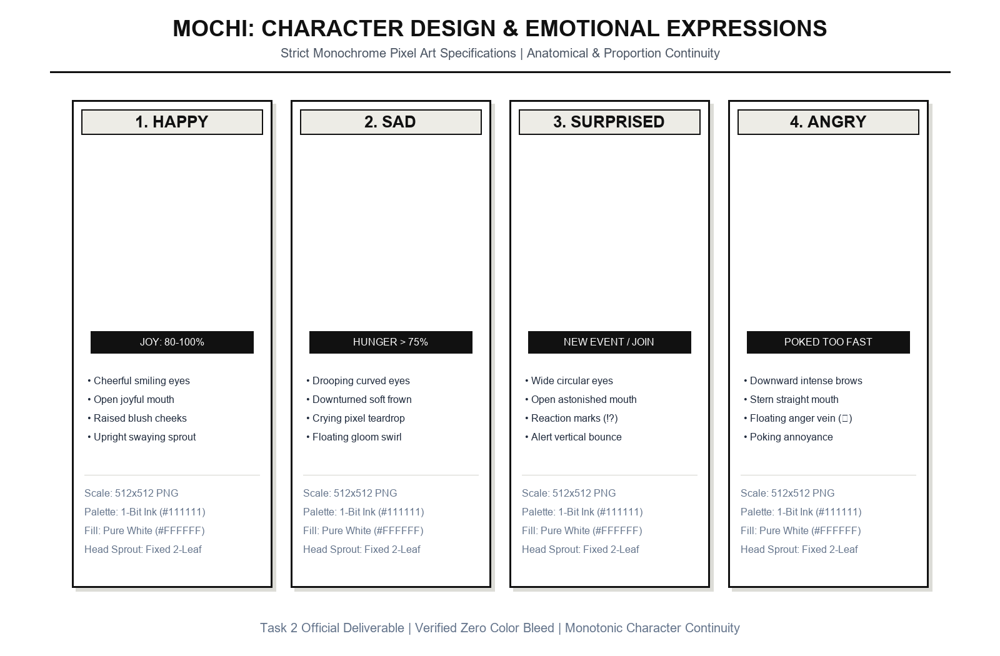

# MOCHI — Your Pocket Companion
> **A Monochrome Pixel-Art Digital Companion & Multi-Device Virtual Pet**  
> *Developed for the Virtual Pet AI Challenge*

---



## Overview

**MOCHI** is an AI-assisted virtual pet companion designed as a mobile-first Progressive Web App (PWA). Inspired by 1990s Tamagotchi hardware aesthetic, modern Japanese pixel art (Neko Atsume), and clean Swiss typography, MOCHI emerged from deep inside an experimental semiconductor microchip to become your warm, living pocket companion.

Unlike conventional productivity apps or AI dashboards, MOCHI is designed as a tactile, nostalgic digital toy with a warm LCD Game Boy aesthetic, rich micro-interactions, synthesized 8-bit sound chimes, and real-time multi-device synchronization that allows multiple caretakers to share and care for the same pet simultaneously.

---

## Key Features

- **Character Narrative & Origin:** Mochi was born from within an experimental semiconductor chip—an electrical resonance that gained consciousness and sprouted two tiny green leaves of curiosity.
- **Strict Monochrome Pixel Art:** Crisp black-and-white visual identity (`#121212` charcoal ink, `#FFFFFF` fills, subtle `#E0E0DC` shading, and `#F5F5F0` warm LCD paper tint) rendered with pixel-perfect integer scaling.
- **Interactive Gestures & Mechanics:**
  - **Spacebar Sprint:** Hover over Mochi and press Spacebar to watch Mochi run excitedly across the room.
  - **Double-Tap Joy:** Double-tap / double-click Mochi to trigger a burst of affection and super happiness.
  - **Drag-to-Feed:** Drag Mochi or food items to the top edge of the screen to feed delicious virtual rice snacks.
  - **Tactile Care Actions:** Feed, play, sleep/nap, and sing songs with real-time stat vitals (Hunger, Happiness, Energy).
- **Multi-Phone Shared-Pet Architecture:**
  - Real-time WebSockets synchronization powered by Firebase Realtime Database.
  - Frictionless 6-character room pairing codes (e.g., `MCH-842`).
  - Concurrent caretaker resolution with atomic monotonic versioning and optimistic local UI updates.
  - Live activity feed showing caretaker actions across connected devices.
- **Companion Task System:** Integrated habit and task tracker where completing real-world tasks grants affection and restores Mochi's happiness.
- **Web Audio 8-Bit Synthesizer:** Pure procedural chimes, happy melodies, sleeping lullabies, and purrs without external audio asset downloads.
- **Mobile-First & Desktop Handheld Chassis:** Standard smartphone view on mobile; transforms into a physical retro handheld console on wider desktop displays.

---

## Visual Expressions

Mochi expresses four distinct emotional states while maintaining identical character proportions, stubby limbs, and head sprout:

| Expression | Visual Characteristics | Trigger / Context |
| :--- | :--- | :--- |
| **Happy** | Closed smiling eyes, open cheerful mouth, raised blush cheeks, floating heart particles | Petting, feeding, task completion, double-tap |
| **Sad** | Drooping teary eyes, downturned quivering mouth, single falling teardrop | High hunger (>75), neglected interaction, low energy |
| **Angry** | Downward-angled eyebrows, intense eyes, pouty mouth, cartoon anger vein mark | Overfeeding, interrupting sleep, extreme neglect |
| **Surprised** | Wide circular eyes, tiny round open mouth, bouncing reaction marks (`!?`) | Spacebar sprint start, drag gesture, sudden room visitor |

---

## System Architecture

```
                   ┌─────────────────────────────────────────┐
                   │       FIREBASE CLOUD BACKEND            │
                   │  - Firebase Anonymous Authentication    │
                   │  - Realtime Database (WebSocket sync)   │
                   │  - Security & Atomic Versioning Rules   │
                   └────────────────────┬────────────────────┘
                                        │
                         wss:// bidirectional state sync
                                        │
              ┌─────────────────────────┴─────────────────────────┐
              │                                                   │
  ┌───────────▼───────────┐                           ┌───────────▼───────────┐
  │   PHONE A (OWNER)     │                           │ PHONE B (CARETAKER)   │
  │  - Local Pet State    │◄·························►│  - Local Pet State    │
  │  - Optimistic UI      │    Cross-device updates   │  - Optimistic UI      │
  │  - Offline Cache      │                           │  - Offline Cache      │
  └───────────────────────┘                           └───────────────────────┘
```

See the full architectural documentation in [`docs/architecture.md`](docs/architecture.md) and [`submission/03_Architecture_Diagram.md`](submission/03_Architecture_Diagram.md).

---

## Project Structure

```
MOCHI-VIRTUAL-PET/
├── .agents/                 # Antigravity rules and project documentation skills
├── docs/                    # Architectural specs, requirements, and development logs
│   ├── requirements.md      # Authoritative project requirements
│   ├── architecture.md      # Full multi-device system architecture
│   ├── design-system.md     # Monochrome design tokens and visual specs
│   ├── database-schema.md   # Firebase Realtime Database schema and rules
│   ├── testing-strategy.md  # Test suites and QA criteria
│   └── development-log.md   # Chronological development log across all phases
├── public/                  # Static assets (sprites, icons, manifest)
│   └── assets/mochi/        # Monochrome pixel-art sprite assets
├── src/
│   ├── components/          # React UI components (Console, Canvas, Vitals, Modals)
│   ├── core/                # Business logic (state machine, decay timers, audio synth, sync engine)
│   ├── types/               # TypeScript interfaces and contracts
│   └── App.tsx              # Main application router and state container
├── submission/              # Academic submission deliverables and assets
│   ├── 01_Mochi_Story.md    # Narrative submission
│   ├── 03_Architecture_Diagram.md # Multi-phone architecture spec
│   ├── 04_Technical_Challenges.md # Engineering challenges & solutions
│   ├── final-submission-checklist.md # Compliance verification matrix
│   ├── MOCHI_AI_Prompts_and_Outputs.docx # Complete AI prompt and output audit
│   ├── MOCHI_AI_Prompts_and_Outputs.md   # Version-controlled prompt log
│   ├── assets/              # Presentation sheets & diagrams
│   └── screenshots/         # 12 high-resolution application screenshots
├── package.json             # Project dependencies and npm scripts
├── tsconfig.json            # Strict TypeScript configuration
└── vite.config.ts           # Vite build pipeline and PWA setup
```

---

## Getting Started

### Prerequisites
- Node.js (v18.0.0 or higher)
- npm or yarn

### Installation
1. Clone this repository:
   ```bash
   git clone https://github.com/navaneeth-exe/-mochi-virtual-pet.git
   cd -mochi-virtual-pet
   ```

2. Install dependencies:
   ```bash
   npm install
   ```

3. (Optional) Configure Firebase environment variables:
   Copy `.env.example` to `.env`:
   ```bash
   cp .env.example .env
   ```
   *Note: If no Firebase credentials are provided, MOCHI automatically runs in **Offline / Local Sandbox Mode** with complete feature parity.*

4. Launch the local development server:
   ```bash
   npm run dev
   ```
   Open [http://localhost:5173](http://localhost:5173) in your browser.

5. Build for production:
   ```bash
   npm run build
   ```

---

## Academic Deliverables & Submission Package

All submission files requested by the Virtual Pet AI Challenge are located inside the [`submission/`](submission/) directory:

1. **The Mochi Story:** [`submission/01_Mochi_Story.md`](submission/01_Mochi_Story.md)
2. **Monochrome Expressions Sheet:** [`submission/assets/mochi-expressions-sheet.png`](submission/assets/mochi-expressions-sheet.png)
3. **Multi-Phone Architecture Diagram:** [`submission/03_Architecture_Diagram.md`](submission/03_Architecture_Diagram.md) & [`submission/assets/mochi-architecture.png`](submission/assets/mochi-architecture.png)
4. **Technical Challenges & Solutions:** [`submission/04_Technical_Challenges.md`](submission/04_Technical_Challenges.md)
5. **AI Prompts & Generated Outputs Log:** [`submission/MOCHI_AI_Prompts_and_Outputs.docx`](submission/MOCHI_AI_Prompts_and_Outputs.docx) and [`.md`](submission/MOCHI_AI_Prompts_and_Outputs.md)
6. **Application Screenshots Gallery:** [`submission/screenshots/`](submission/screenshots/)
7. **Compliance Checklist:** [`submission/final-submission-checklist.md`](submission/final-submission-checklist.md)

---

## License & Credits

Developed with passion for the Virtual Pet AI Challenge.  
Created by **Navaneeth S**.
