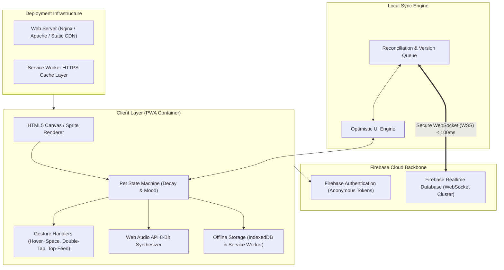
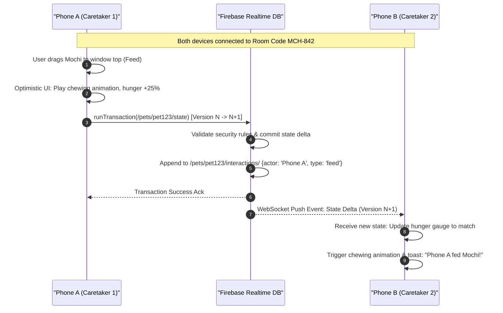
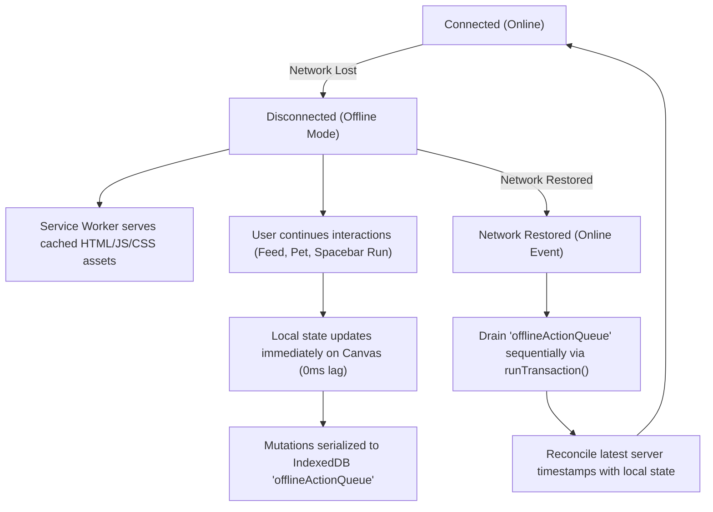
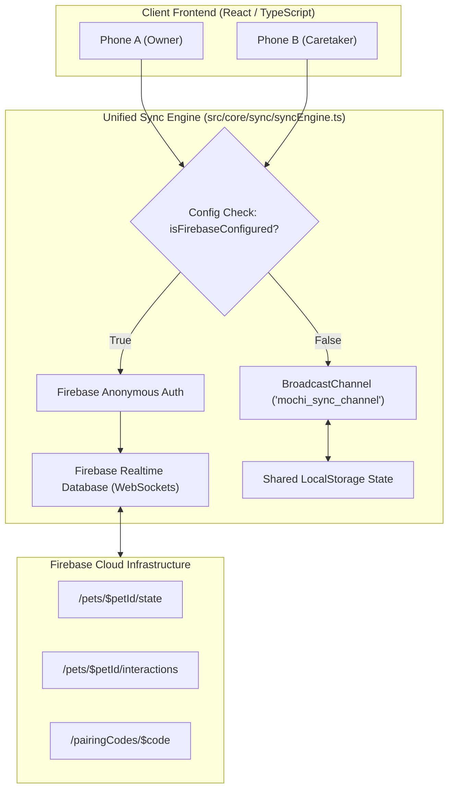

# System Architecture Specification — MOCHI: Your Pocket Companion

> **Document Status:** Finalized Phase 2 Architecture  
> **Target Platform:** Mobile-First Progressive Web App (PWA) with Multi-Device Cloud Sync  
> **Backend Service:** Firebase Realtime Database & Firebase Authentication

---

## 1. High-Level System Architecture

MOCHI utilizes a decoupled client-server architecture tailored for low latency, offline resilience, and friction-free multi-device synchronization.



---

## 2. Multi-Device Realtime Connection & Co-Parenting

A signature capability of MOCHI is allowing multiple devices (Phone A, Phone B, Tablet, Laptop) to nurture the exact same pet instance simultaneously.



### 2.1 Connection & Authentication Lifecycle
1. **Frictionless Anonymous Onboarding:**
   - On first launch, the app initializes the Firebase SDK and invokes `signInAnonymously(auth)`.
   - The user is issued a persistent anonymous JWT token and unique `uid`. No email or password friction is required.
   - The user's chosen display alias (e.g. "Alex's Phone") is cached in `localStorage`.
2. **Shared Pet Room Identification:**
   - Each pet room is assigned a globally unique UUID `petId` (e.g., `pet_abc123_xyz`).
   - A friendly, cryptographically randomized 6-character alphanumeric code is mapped to the pet ID in `/pairingCodes/<CODE>` (e.g., `MCH-842`).
   - Phone B joins simply by typing `MCH-842`. The system verifies the code, reads the corresponding `petId`, and registers Phone B's `uid` under `/pets/<petId>/members/<uid>`.

---

## 3. Synchronization & Concurrency Model

### 3.1 How Pet Statistics are Synchronized
To avoid excessive network traffic and battery depletion, stat decay is **anchored to server timestamps** rather than continuously written by timer loops:
- The database stores:
  - `baseHunger` (stat value at last interaction, 0–100)
  - `baseHappiness` (stat value at last interaction, 0–100)
  - `baseEnergy` (stat value at last sleep/wake, 0–100)
  - `lastFedTimestamp` (server epoch milliseconds)
  - `lastInteractedTimestamp` (server epoch milliseconds)
  - `lastSleptTimestamp` (server epoch milliseconds)
- Each connected device evaluates current vitals locally on-demand using pure mathematical formulas:
  $$\text{effectiveHunger} = \max\left(0, \text{baseHunger} - \left\lfloor \frac{(\text{now} - \text{lastFedTimestamp}) \times 100}{\text{decayDurationMs}} \right\rfloor\right)$$
- When any device feeds Mochi, it commits a fresh `baseHunger` and updates `lastFedTimestamp = now`. All other devices immediately recalculate against the new baseline.

### 3.2 How Task Data is Stored
Companion tasks are stored under the pet room:
```json
{
  "pets": {
    "<petId>": {
      "tasks": {
        "<taskId>": {
          "title": "Drink a glass of water",
          "isCompleted": false,
          "createdAt": 1731481200000,
          "completedAt": null,
          "completedBy": null,
          "rewardBerries": 1
        }
      }
    }
  }
}
```
When either caretaker completes a task, `isCompleted` flips to `true`, Mochi performs a celebratory flip on both phones, and the room's shared berry stockpile increments by $+1$.

### 3.3 Handling Simultaneous Updates (Concurrency & Race Conditions)
If Phone A and Phone B perform actions at the exact same millisecond:
- All state modifications run inside **Firebase Atomic Transactions** (`runTransaction()`):
  ```typescript
  await runTransaction(stateRef, (current) => {
    if (!current) return current;
    return {
      ...current,
      baseHunger: Math.min(100, current.baseHunger + 25),
      lastFedTimestamp: Date.now(),
      version: (current.version || 0) + 1
    };
  });
  ```
- If a version collision occurs, Firebase automatically discards the stale local payload, retrieves the updated server state, re-evaluates the mutation function, and re-submits. No writes are dropped.

### 3.4 Preventing Unauthorized Access (Firebase Security Rules)
Security rules in `database.rules.json` enforce strict access boundaries:
1. **Authentication Requirement:** All reads and writes require `auth != null`.
2. **Membership Authorization:** A user can only read or write to `/pets/<petId>` if their `auth.uid` is registered under `/pets/<petId>/members/<auth.uid>`.
3. **Schema Validation:**
   - `hunger`, `happiness`, `energy` must be integers between $0$ and $100$.
   - `currentEmotion` must be one of `"happy"`, `"sad"`, `"surprised"`, `"angry"`, or `"idle"`.
   - `version` must be a positive integer.

---

## 4. Offline Resilience & Network Reconnection



1. **Asset Caching:** The Service Worker pre-caches all sprite sheets, sound synthesis algorithms, and application bundles. The app boots in under 1 second even in airplane mode.
2. **Offline Interaction Queue:** If a caretaker feeds Mochi while offline, the interaction is applied locally and appended to an IndexedDB queue with a client timestamp.
3. **Reconnection Flush:** When the browser detects an `online` event, the queue flushes sequentially using atomic transactions, reconciling stats gracefully without overwriting newer actions from online co-caretakers.

---

## 5. Web Server Configuration & Production Deployment Pipeline

In accordance with Task 3's deployment criteria (Build Game $\to$ Upload $\to$ Config Nginx/Apache $\to$ Test):

### 5.1 Nginx Production Configuration (`nginx.conf`)
```nginx
server {
    listen 80;
    server_name mochi.internal;
    return 301 https://$host$request_uri;
}

server {
    listen 443 ssl http2;
    server_name mochi.internal;

    ssl_certificate /etc/ssl/certs/mochi.crt;
    ssl_certificate_key /etc/ssl/private/mochi.key;

    root /var/www/mochi-virtual-pet/dist;
    index index.html;

    # Performance compression
    gzip on;
    gzip_types text/plain text/css application/json application/javascript image/svg+xml image/png;

    # PWA Service Worker caching policy: NEVER cache sw.js
    location = /sw.js {
        add_header Cache-Control "no-cache, no-store, must-revalidate";
        add_header Pragma "no-cache";
        expires 0;
    }

    # Static assets long-term cache
    location /assets/ {
        add_header Cache-Control "public, max-age=31536000, immutable";
    }

    # SPA routing fallback
    location / {
        try_files $uri $uri/ /index.html;
    }
}
```

### 5.2 Apache Production Configuration (`.htaccess`)
```apache
<IfModule mod_rewrite.c>
    RewriteEngine On
    RewriteBase /
    RewriteRule ^index\.html$ - [L]
    RewriteCond %{REQUEST_FILENAME} !-f
    RewriteCond %{REQUEST_FILENAME} !-d
    RewriteRule . /index.html [L]
</IfModule>

<FilesMatch "sw\.js$">
    Header set Cache-Control "no-cache, no-store, must-revalidate"
</FilesMatch>
```

---

## 6. Phase 5 Implementation: Real-Time Synchronization Engine Architecture

### 6.1 Dual-Engine Abstraction Pattern
To fulfill the mandatory multi-device shared pet requirement while adhering strictly to security best practices (never fabricating live credentials or committing secrets):
- **Live Cloud Engine:** Uses official `@firebase/app`, `@firebase/auth`, and `@firebase/database` packages communicating via persistent low-latency WebSockets. Activated automatically whenever `VITE_FIREBASE_API_KEY` is present in `.env`.
- **Local Broadcast Engine:** Uses modern HTML5 `BroadcastChannel` (`mochi_sync_channel`) combined with `localStorage` cross-tab storage synchronizer. Allows instant multi-window local testing without requiring active internet connectivity or third-party cloud setup.



### 6.2 Atomic Concurrency and Conflict Resolution
- **Monotonic Version Clocks:** All state mutations increment `state.version = (current.version || 0) + 1`.
- **Atomic Transactions:** When interacting in cloud mode, `runTransaction(ref(db, 'pets/' + petId + '/state'), ...)` ensures race conditions resolve deterministically. If two caretakers feed Mochi at the exact same millisecond, the second transaction retries with the freshly committed hunger value.
- **Cross-Caretaker Interaction Stream:** Device actions append event payloads to `/pets/$petId/interactions/` (or broadcast `STATE_MUTATED` events), which trigger real-time toast alerts on all connected co-parent phones.
