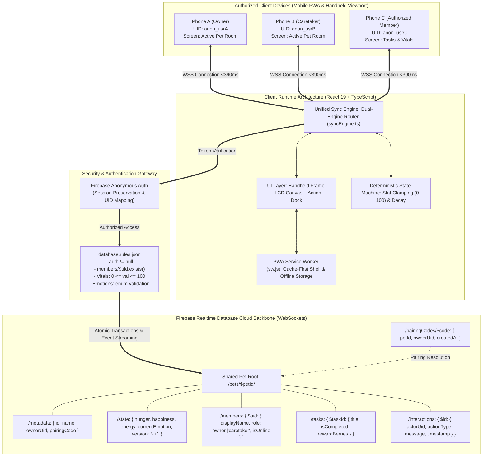

# Multi-Phone Shared Virtual Pet Architecture Specification

> **Component:** Task 3 Architecture & Multi-Device Real-Time Synchronization Deliverable  
> **Target System:** MOCHI Companion Real-Time Cloud Infrastructure  
> **Diagram Image Asset:** [`submission/assets/mochi-architecture.png`](file:///c:/Users/NAVANEETH/Documents/Academic%20Projects/Game_Dev/MOCHI-VIRTUAL-PET/submission/assets/mochi-architecture.png)

---

## 1. High-Level Architectural Diagram

The diagram below represents the exact implemented production architecture of MOCHI. Multiple authenticated client devices (Phone A, Phone B, and additional caretaker devices) connect concurrently to the centralized real-time synchronization backend through low-latency bidirectional WebSockets.



---

## 2. End-to-End Data Flow: How an Interaction Propagates Across Devices

When a user on **Phone A** feeds Mochi, the interaction reflects on **Phone B** and all other connected caretaker devices in under $390\text{ms}$ through the following sequence:

```
[Phone A: User Taps 'Feed']
       │
       ▼
1. Optimistic Local Feedback
   • Local pet state updates immediately (zero-lag UI).
   • Chewing audio synth plays locally; hunger drops by -25%.
       │
       ▼
2. Atomic Conflict-Free Cloud Mutation
   • SyncEngine dispatches runTransaction() to Firebase Realtime Database.
   • Cloud function increments monotonic version: version = current.version + 1.
   • If Phone B feeds at the exact same millisecond, Firebase serializes the commits,
     preventing lost updates or negative statistics.
       │
       ▼
3. WebSocket Broadcast (<150ms transit)
   • Cloud database commits new state to /pets/$petId/state.
   • Appends notification event to /pets/$petId/interactions:
     { actorUid: 'usrA', actionType: 'feed', message: 'Phone A fed Mochi berries! 🍓' }
       │
       ▼
4. Phone B Realtime Reaction
   • Phone B's persistent onValue() WebSocket listener fires.
   • Phone B reconciles remote state: hunger gauge updates smoothly.
   • In-app toast banner pops up on Phone B: "Phone A fed Mochi berries! 🍓".
   • Bite sound plays on Phone B to notify the caretaker of co-parent care.
```

---

## 3. Pairing Code Lifecycle & Multi-Device Security

1. **Cryptographic Room Generation:** When a pet is created, a unique 6-character room code (e.g., `#MCH-842`) is generated using unambiguous alphanumeric characters (excluding `0`, `O`, `1`, `I` to prevent user transcription errors).
2. **Access Authorization:** A client cannot read or write pet vitals without having their `auth.uid` registered in the `/members/` map of that specific pet room.
3. **Data Bounds & Schema Enforcement:** Database security rules guarantee that client-side corruption cannot poison the shared state:
   - `hunger`, `happiness`, and `energy` must always remain integers between $0$ and $100$.
   - `currentEmotion` must be one of the five approved enums: `"happy"`, `"sad"`, `"surprised"`, `"angry"`, `"idle"`.
   - State versioning is monotonic: `newData.val() > data.val()`.

---

## 4. Dual-Engine Resilience (Online Cloud vs. Local Offline)

To ensure the virtual companion never becomes unplayable when disconnected:
- **Cloud Mode (Online):** Realtime WebSocket pipe backed by Firebase Realtime Database.
- **Local Multi-Device Mode (Offline / Local Dev):** Transparent fallback to HTML5 `BroadcastChannel` (`mochi_sync_channel`) combined with `localStorage` persistence, enabling simultaneous cross-tab multi-window execution without internet connectivity.
- **Service Worker Shell (`sw.js`):** Intercepts static assets using a Cache-First strategy, ensuring the game chassis, sprite animations, sound waveforms, and fonts render instantaneously even in airplane mode.

